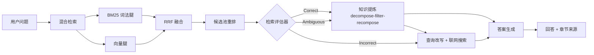

# Rail-CRAG

面向铁路标准文档的 **Corrective RAG** 问答系统：混合检索（BM25 + 向量 + RRF + 重排）→ 检索评估 → 知识提炼 / 联网纠错 → 带来源的回答。

[](https://github.com/N1rvana-git/Agent-Pingbot/actions/workflows/ci.yml)


## 1. 问题与做法

铁路标准问答有两个难点：标准号、限值、条款这类**精确标识符**必须一字不差地命中；而工程人员的提问往往是口语化改写（"列车跑太快会不会撞到隧道壁"）。单一路检索无法同时覆盖两者。

系统按 CRAG 论文拆成三步，并在检索层做了工程化：

| 能力 | 实现 | 作用 |
| --- | --- | --- |
| 精确匹配 | BM25（中文字符 + bigram + 英文/数字 token） | 命中 `TB 10621`、`SIL4`、`0.3mm` 这类硬约束 |
| 语义召回 | 向量检索（ChromaDB） | 覆盖口语化提问和同义表达 |
| 结果融合 | RRF（`k=60`） | 两路分数量纲不同，只按名次融合，无需调参 |
| 精排 | 启发式重排（查询覆盖率 + 章节命中 + 标准号命中 + 长度惩罚） | 把真正回答问题的条款顶到前面 |
| 纠错 | CRAG 评估器输出 Correct / Incorrect / Ambiguous | Correct 走知识提炼，Incorrect 走查询改写 + 联网搜索 |
| 可溯源 | 每个片段保留 `source` + 章节 `path` | 回答可以标注依据的标准章节 |

没有 API Key 时，系统用确定性哈希向量 + 词面评估器运行完整链路，CI 与本地演示都不需要联网。

## 2. 架构



组件边界：

- `src/rag/`：检索层。`store.py` 是唯一接触 ChromaDB 的模块；`retriever.py` 负责 BM25、RRF、重排；`evaluation.py` 负责指标；`embeddings.py` 负责向量后端与降级。
- `src/graph/`：LangGraph 编排。节点只处理状态，不直接读写数据库。
- `src/ingestion/`：MinerU / Markdown 解析、清洗、切分与入库。
- `src/components/`：评估器、提炼器、改写器、搜索器、生成器。

## 3. 快速开始

```bash
python -m venv .venv
source .venv/bin/activate        # Windows: .venv\Scripts\activate
pip install -r requirements.txt
cp .env.example .env             # 可留空 Key，离线运行
```

建立索引并提问：

```bash
python -m src.main ingest --file data/railway_standard_guide.md --reset
python -m src.main chat --query "时速350公里路段的最小曲线半径是多少？"
```

HTTP 服务与可视化：

```bash
python -m uvicorn src.server:app --port 8000   # Swagger: http://127.0.0.1:8000/docs
streamlit run ui.py                            # http://127.0.0.1:8501
```

Docker：

```bash
cp .env.example .env
docker compose up --build
```

PDF 解析是可选的，需要安装 MinerU 工具链（见 [docs/pdf_ingestion.md](docs/pdf_ingestion.md)）：

```bash
pip install -r requirements-pdf.txt
python -m src.main ingest --file data/standard.pdf
```

## 4. 检索消融

评测集 `tests/data/retrieval_eval.json` 含 24 条查询，语料为 `data/railway_standard_guide.md` 切出的 27 个片段。指标口径写在 `src/rag/evaluation.py`：`HitRate@k`、`MRR`、`nDCG@k`，命中定义为结果正文或章节路径包含任一期望关键词。

```bash
python scripts/eval_retrieval.py --top-k 5
python scripts/eval_retrieval.py --top-k 1
```

**Top-5（供 RAG 使用）**，单机 CPU、哈希向量：

| 配置 | HitRate@5 | MRR | nDCG@5 | 平均延迟 |
| --- | ---: | ---: | ---: | ---: |
| BM25 | 100.0% | 1.000 | 1.000 | 3.2 ms |
| Vector | 100.0% | 0.979 | 0.985 | 4.9 ms |
| Hybrid (RRF) | 100.0% | 1.000 | 1.000 | 3.6 ms |
| Hybrid + Rerank | 100.0% | 1.000 | 1.000 | 7.1 ms |

**Top-1（看排序精度）**：

| 配置 | HitRate@1 | MRR | nDCG@1 | 平均延迟 |
| --- | ---: | ---: | ---: | ---: |
| BM25 | 100.0% | 1.000 | 1.000 | 3.1 ms |
| Vector | 95.8% | 0.958 | 0.958 | 3.6 ms |
| Hybrid (RRF) | 100.0% | 1.000 | 1.000 | 3.5 ms |
| Hybrid + Rerank | 100.0% | 1.000 | 1.000 | 7.2 ms |

读法：

- k=5 时召回已经饱和，说明在这个规模的语料上**检索不是瓶颈**，回答质量取决于提炼与生成；k=1 才能看出差异：纯向量漏掉 1 条，混合检索把它补了回来。
- 哈希向量本质上是词面特征的另一种加权，和 BM25 高度相关，所以 Vector 与 Hybrid 接近；配置 `EMBEDDING_BASE_URL` 换成真实语义向量后，这一列才会体现语义召回的收益。
- 重排在当前 24 条评测上没有带来指标提升，只增加约 3.5ms（约为纯 RRF 的 2 倍）。它解决的是"融合结果把泛化章节排在带标准号的章节前面"这类排序错误，单元测试覆盖了该行为；是否默认开启应按语料规模和延迟预算决定（`RAG_RERANK=0` 可关闭），而不是假设"多加一层总更好"。

CI 用 `--top-k 1 --min-hit-rate 0.95` 作为回归门槛：检索层退化会直接红灯。

## 5. 配置

| 变量 | 默认 | 说明 |
| --- | --- | --- |
| `OPENAI_API_KEY` | 空 | 空 = 离线模式（提取式回答） |
| `OPENAI_BASE_URL` | OpenAI | 兼容网关地址（DeepSeek 等） |
| `OPENAI_EVAL_MODEL` / `OPENAI_GEN_MODEL` / `OPENAI_REWRITE_MODEL` | gpt-4o-mini / gpt-4o / gpt-4o | 三个角色的模型 |
| `TAVILY_API_KEY` | 空 | 空 = 跳过联网纠错 |
| `EMBEDDING_BACKEND` | auto | `auto` / `hashing` / `openai` |
| `EMBEDDING_BASE_URL` / `EMBEDDING_MODEL` / `EMBEDDING_DIM` | 空 | OpenAI 兼容的 `/embeddings` 服务 |
| `CHROMA_PERSIST_DIR` / `COLLECTION_NAME` | `./data/chroma` / `rail_crag` | 索引位置与集合名 |
| `RETRIEVER_K` | 5 | 进入图的片段数 |
| `RETRIEVAL_MODE` | hybrid | `hybrid` / `bm25` / `vector` |
| `RRF_K` / `RETRIEVAL_POOL` | 60 / 20 | 融合常数与重排候选池 |
| `RAG_RERANK` | 1 | 是否重排 |
| `CRAG_UPPER_THRESHOLD` / `CRAG_LOWER_THRESHOLD` | 0.5 / -0.5 | Correct / Incorrect 判定阈值 |

所有配置在 `src/config.py` 集中解析并在启动时校验，非法值直接报错而不是等到第一次查询才暴露。

## 6. 接口

| 方法 | 路径 | 说明 |
| --- | --- | --- |
| `GET` | `/healthz` | 索引规模、向量后端、检索配置、模型开关 |
| `POST` | `/chat` | 走完整 CRAG；可传 `mode` / `rerank` 覆盖默认检索配置 |
| `POST` | `/retrieve` | 只做检索，返回 BM25 / 向量 / 混合 / 重排四路对照 |
| `POST` | `/ingest` | 上传 Markdown 并入库（同一 `source_name` 会被替换） |

```bash
curl -s http://127.0.0.1:8000/chat \
  -H "Content-Type: application/json" \
  -d '{"query":"CTCS-3 级列控系统叠加了什么通信方式？"}' | python -m json.tool
```

## 7. 目录结构

```text
src/
  rag/           检索层：text / embeddings / store / retriever / reranker / evaluation
  graph/         LangGraph 状态、节点与编译
  ingestion/     Markdown 清洗切分、MinerU PDF 加载、入库流水线
  components/    评估器、提炼器、查询改写、联网搜索、生成器
  evaluation/    Standard RAG vs CRAG 对比脚本
scripts/         检索消融 CLI
tests/           97 条单元/集成测试 + 检索评测集
data/            示例语料（铁路标准指南、标准片段）
docs/            检索链路说明、PDF 接入、演示脚本
```

## 8. 测试

```bash
python -m unittest discover -s tests -t . -v
```

覆盖范围：分词与哈希向量、Markdown 清洗/切分、Chroma 写入与幂等、BM25/RRF/重排、指标公式、配置校验、入库流水线与图端到端（含离线模式）。

## 9. 已知边界

- **哈希向量不是语义模型**。它保证离线可复现，但同义改写仍会漏召回；生产环境应配置真实 embedding 服务。
- **单进程、无鉴权**。适合内网演示；多副本需要把会话与索引写入外置存储。
- **评测集是关键词锚定的**，衡量的是"能不能把正确条款排上来"，不衡量回答的事实正确性；生成质量需要另做人工/模型评审。
- **重排器是启发式的**，没有训练数据；它的价值在可解释和可复现，而不是 SOTA。

## 10. 参考

- [Corrective Retrieval Augmented Generation (arXiv:2401.15884)](https://arxiv.org/abs/2401.15884)
- [MinerU / Magic-PDF](https://github.com/opendatalab/MinerU)
- [LangGraph](https://langchain-ai.github.io/langgraph/)
